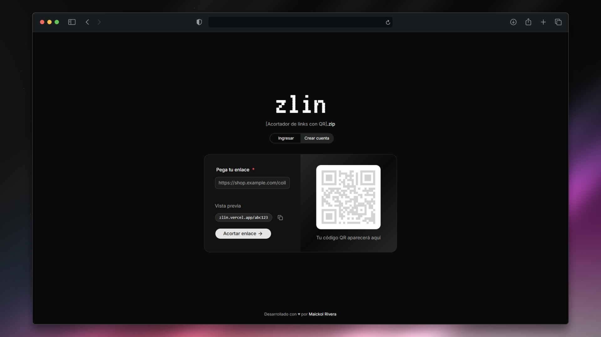

<div align="center">
  
# Zlin

**A fast URL shortener with QR codes, link expiration and click tracking.**

React + TypeScript frontend and an ASP.NET Core API with JWT authentication and PostgreSQL.

[](https://zlin.vercel.app)




</div>

## Features

- **Short links** that redirect to the original URL through a short code.
- **QR codes** generated for each link, ready to share or download.
- **Link expiration**: set an optional expiration date (it must be in the future).
- **Click tracking**: every link keeps its own click counter.
- **User accounts** with registration, login and JWT-based authentication.
- **Personal link list**: signed-in users can list and delete their links.
- **Typed, validated frontend** built with reusable shadcn/ui components.

## Tech Stack

**Frontend**

- **React** + **TypeScript**, bundled with **Vite**
- **Tailwind CSS 4** + **shadcn/ui** (Radix UI) + lucide-react icons
- **React Router** for navigation and **qrcode.react** for QR codes
- **Oxlint** for linting, **pnpm** as package manager

**Backend**

- **ASP.NET Core** (.NET 10) with minimal APIs
- **Entity Framework Core** + **Npgsql** (PostgreSQL) with migrations
- **JWT Bearer** authentication
- **OpenAPI** documentation support
- **Docker** image for deployment

**Infrastructure**

- Frontend on **Vercel**, API on **Render** (blueprint included), PostgreSQL on **Neon**
- **GitHub Actions** keep-alive workflow for the free Render plan

## API Overview

| Method | Route | Description |
| --- | --- | --- |
| `POST` | `/api/links` | Create a short link (optional expiration date). |
| `GET` | `/api/links` | List the signed-in user's links. Requires authentication. |
| `DELETE` | `/api/links/{code}` | Delete one of your links. Requires authentication. |
| `GET` | `/{code}` | Redirect to the original URL. |
| `GET` / `HEAD` | `/health` | Health check for uptime monitors. |

## Getting Started

### Requirements

- [.NET 10 SDK](https://dotnet.microsoft.com/download)
- [Node.js](https://nodejs.org/) and [pnpm](https://pnpm.io/)
- A PostgreSQL database (local or hosted, such as Neon)

### Installation

```bash
git clone https://github.com/MaickolRivera/zlin.git
cd zlin
```

### Backend

Configure the PostgreSQL connection string and a JWT signing key (at least 32 characters) in `backend/src/Zlin.Api/appsettings.Development.json` or through environment variables, then apply the migrations and start the API:

```bash
cd backend
dotnet tool restore
dotnet ef database update --project src/Zlin.Api
dotnet run --project src/Zlin.Api
```

### Frontend

Copy `.env.example` to `.env` and set `VITE_BASE_URL` (public URL of the app) and `VITE_API_URL` (URL of the API):

```bash
cd frontend
cp .env.example .env
pnpm install
pnpm dev
```

Other scripts: `pnpm build`, `pnpm lint` and `pnpm preview`.

## Project Structure

```text
zlin/
├── backend/
│   ├── Dockerfile
│   └── src/Zlin.Api/
│       ├── Data/           # EF Core DbContext
│       ├── Domain/         # User and ShortLink entities
│       ├── Dtos/           # Request and response models
│       ├── Endpoints/      # Auth and link endpoints
│       ├── Services/       # Auth, token and link logic
│       ├── Migrations/     # Database migrations
│       └── Program.cs
├── frontend/
│   ├── public/             # Favicon, icons and preview image
│   └── src/
│       ├── components/     # UI components (shadcn/ui)
│       ├── lib/            # API client, auth and helpers
│       └── pages/          # Home, login, register and redirect
├── .github/workflows/      # Keep-alive workflow
└── render.yaml             # Render blueprint for the API
```

## Deployment

- **API:** deployed on Render from the included `Dockerfile` and `render.yaml` blueprint. The `/health` route accepts `GET` and `HEAD` requests so uptime monitors can keep the free plan awake.
- **Frontend:** deployed on Vercel from the `frontend` folder.

## Contributing

Contributions are welcome. Feel free to open an issue or submit a pull request with improvements.

---

<div align="center">

Made with ❤️ by Maickol Rivera

</div>

